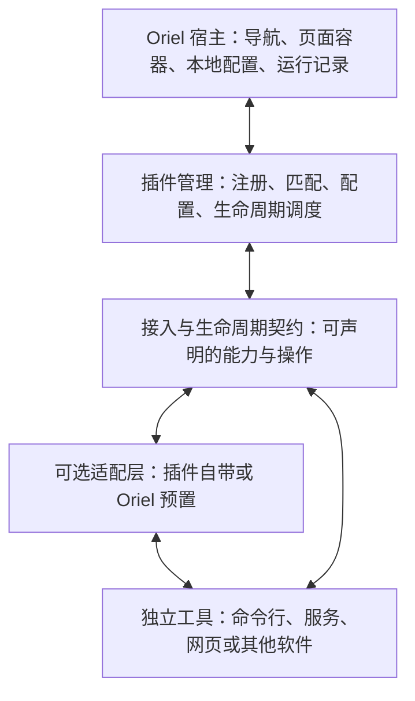

# Oriel 当前设计基线

- 更新日期：2026-10-27。
- 阶段：内置浏览器与网页接入初版；保留首页外壳，新增声明登记、本地配置、独立原生网页视图、代理及 Windows 原生密码保存与填充。
- 关联资料：[设计决策记录](workspace-and-plugins.md)。
- 初版界面：[首页与视觉设计](home-and-identity.md)。

本文以最新确认覆盖旧讨论。“已确认”是用户明确表达的方向；“建议”是实现这些方向的候选方案；“延后”表示当前不继续讨论或规划具体实现。当前已交付内置浏览器及网页接入所需的声明、配置与本地调用。已新增 Windows 本地服务生命周期与前置资源最小接入，供独立工具 Tether 与 Script Studio 使用；准确契约见[本地服务与前置资源](local-services.md)，不将业务动作扩展为通用工作流引擎。

## 1. 产品与框架定位

Oriel 是面向个人独立工具的可配置工作台，以插件方式扩展，并逐步形成服务于 Oriel 自身及其插件开发的框架。

**已确认：框架只服务 Oriel 及其插件，暂不以第三方构建另一个独立工作台产品为目标。** 可以随产品开发沉淀可复用模块、接入规范和开发支持，具体发布组织方式仍按后文建议演进。

工具保持独立仓库、开发环境、部署方式、业务数据和独立使用方式。Oriel 负责统一登记、查找、获取、安装、启动、访问、展示和必要记录，不要求所有已有工具改造成 Oriel 专属软件。

Windows 是当前重点，未来手机和服务器按设备能力扩展。接受联网使用，但当前 Oriel 自身配置以本地配置为权威来源。

## 2. 已确认的方向

| 项目 | 当前结论 |
| --- | --- |
| 框架边界 | 只服务 Oriel 与其插件开发 |
| 工具独立 | 有价值的工具独立维护、独立 Git 仓库，离开 Oriel 仍有运行方式 |
| 插件接入 | 新增兼容插件无需重新编译 Oriel |
| 适配方向 | 插件遵循 Oriel 接入规范；Oriel 也可自带适配层连接独立工具 |
| 配置优先 | 获取、更新、安装、启动等步骤可按插件独立配置命令或脚本 |
| 生命周期 | 插件声明自身行为，符合统一生命周期组件的管理规范 |
| 统一主题 | 工作台统一浅深主题，本地配置保存偏好，Windows 原生网页及弹窗跟随 |
| 更新生效 | 按插件支持能力决定是否重启、何时更新和如何生效，不一刀切 |
| 页面 | 允许工具原有页面、终端以及独立适配页面；已有页面也可以不用 |
| 适配归属 | 适配代码可留在 Oriel，目标工具安装后再匹配、启用 |
| 导航 | 左侧可拖拽排序，默认入口可更改；不可用时应回退，并利用当前排序的第 1 个可用入口 |
| 数据权威 | Oriel 管理的配置以本地配置为权威来源 |
| 分层 | 尽量解耦、分层、抽象，协议具备未来提取的条件 |
| 当前阶段 | 内置浏览器：地址栏、浏览导航、网页侧栏入口、原生密码填充、默认代理与网页覆盖 |
| 浏览器布局 | 插件内可展开、收窄和调宽的二级侧栏，只管理用户添加的固定页签，支持拖拽排序 |
| 目录组织 | 内置插件在 plugins/builtin；外部插件支持默认读取目录、额外读取目录及显式登记；开发仓库独立维护 |
| 后续独立工具设计 | Windows SSH 工具 Tether；启动保护已有连接，Oriel 已实现前置资源等待与退出清理，工具业务在独立仓库实现 |
| 独立脚本工具 | Script Studio：Windows 本地脚本管理，独立运行并通过既有本地服务及应用布局接入；业务配置归工具维护 |
| 模态与渲染 | Windows 使用归属主窗口的透明悬浮层，呈现确认后显示；正常悬浮流程保留底层网页，失败回退本地弹窗；原生交互待验收 |
| 插件 UI 插槽 | 可选 sidebar:badge 与 header:action；两种布局共用宿主既有刷新、设置、前置程序动作；未声明时保留原行为 |

新增兼容插件无需重新编译，适用于宿主已支持的扩展能力。需要全新宿主能力时仍可能升级 Oriel。无需编译不等于每个插件必须支持热更新或热卸载。

## 3. 分层与职责

已确认的核心边界：宿主管理通用流程，工具实现业务；接入和生命周期规范让双方协作。适配层可以在插件侧，也可以由 Oriel 提供。

建议进一步按职责分离 UI、配置存取、插件登记、命令执行、生命周期调度、页面展示及平台能力。前端不直接接管任意脚本执行，具体工具差异尽量收敛在适配与声明中，不散落到宿主通用流程。

插件、适配器面向公开接口，避免依赖宿主内部组件实例、数据库表或开发机源码目录。协议具体形式暂不确定，当前不因“可提取”而提前创建独立协议仓库或 SDK。

当前实现中，`oriel-core` 负责声明、入口及本地配置校验；宿主网页能力负责原生视图、浏览操作、代理与平台接口；内置浏览器负责工具栏及密码操作界面。网页声明通过受支持的能力类型选择展示组件，不以某个插件 ID 或 URL 写死路由。规范见[网页接入初版](web-page-plugins.md)。

## 4. 交付与可配置命令

**已确认：交付方式按插件需求决定。** 插件仓库可以提供脚本；Oriel 也可以为每个插件配置独立的获取、更新、安装、启动等命令，不要求所有插件采用同一种包格式或发布渠道。

建议区分以下阶段，名称是概念说明，尚未冻结配置字段：

| 阶段 | 含义 | 可能的提供方式 |
| --- | --- | --- |
| 获取 | 得到所需源码、发布产物或已有本地工具的位置 | 仓库脚本、获取命令、本地登记 |
| 安装 | 完成该工具所需的本地准备 | 安装脚本、独立安装命令；无需安装的工具可不提供 |
| 更新 | 获取并应用目标版本变化 | 更新脚本或命令，并声明运行中更新规则 |
| 启动 | 运行工具或进入其使用方式 | 可执行文件、启动脚本、连接既有服务 |
| 停止 | 结束受管理运行实例 | 工具提供的停止方式或宿主受管理进程回收 |
| 卸载 | 移除该插件或工具的安装内容 | 可选卸载脚本，保留与删除数据规则另行定义 |

获取不等于安装，安装不等于启动；具体插件可以合并实际脚本，但要让管理组件知道步骤的含义与结果。仅连接既有服务的插件不必虚构本地安装流程。

建议命令描述能表达程序、参数、工作目录、环境与执行条件，并由执行层统一记录状态、输出与失败结果。脚本可以用自身需要的语言实现；具体参数格式、错误结构与调用规范后续再定。

注册命令和脚本不等于此刻执行它们；当前实现读取内置及已配置目录中的声明；版本 2 可在用户显式打开服务或依赖页面时运行受信任目录的 stdio-v1 入口，不执行安装或更新动作。浏览器的原生视图创建属于本阶段已授权能力。

## 5. 生命周期规范与插件差异

**已确认：按应用特点管理生命周期，并允许向插件提出规范要求。** 可要求插件提供安装、启动等脚本或等效能力，使其符合 Oriel 生命周期组件的管理规范。

统一的是管理边界与可观察结果，具体启动、停止和更新行为允许由插件实现或声明。

| 管理方面 | 方向 |
| --- | --- |
| 安装与启动 | 由插件提供步骤或配置命令，宿主调度并记录结果 |
| 停止与退出 | 根据受管理关系及工具特征处理，不统一终止所有外部服务 |
| 更新时机 | 按插件声明支持运行中更新、停止后更新或需要重启 |
| 生效时机 | 根据插件能力支持重新连接、重载或应用重启，具体机制延后 |
| 状态与故障 | 管理组件需要知道操作进行中、完成或失败；业务就绪不能只凭进程已启动判定 |
| 能力缺失 | 未提供某项能力时应明确表示不支持或采用已约定的回退行为 |

建议区分 Oriel 创建并管理的进程、已独立运行的本机工具与远程服务。外部服务的停止应是明确操作；生命周期组件只管理自己实际拥有或被明确委托的范围。

页面显示与后台运行相互独立。切走页面或拖动导航不自动终止工具。隐藏入口、停用接入、断开连接和停止工具分别表达。

此前托盘常驻仍可作为候选方向。关闭窗口、完全退出和设备重启时的具体行为由工具能力与本地策略共同决定，后续落实到生命周期规范；Tether 的退出行为已按下文具体确认，其他工具不因此自动采用同一策略。

### Tether 与前置资源（已实现最小接入）

- Tether 是 Windows 本地 SSH 与转发管理工具，保留独立运行方式和独立仓库；其业务配置、密钥与运行连接由工具维护。
- 核心原则是启动新转发不打断现有连接：已有项复用，缺失项形成新批次，同批参数兼容时尽量共用 SSH。停止主要按连接组、主机或全部托管连接处理。
- 外部 SSH 只观测明确可辨识的信息；匹配已登记规则不改变进程归属，也不授予停止或重连权限。
- Oriel 负责插件生命周期和前置动作通用流程，Tether 负责实际 SSH 创建、保活、重连与停止。Windows 使用 `oriel.ps1` 前台 stdio-v1 入口；就绪与公共动作契约见[接入规范](local-services.md)。
- 页面或插件可声明启动前需要 Tether 某条稳定规则 ID。宿主确保提供方可用，调用公共动作，复用已有或正在启动的连接，确认转发就绪后再打开依赖页面。
- 前置资源默认保持到本次 Oriel 会话结束；切换、隐藏或关闭页面以及页面加载失败，不自动回收共享转发。使用方记录用于说明关联与影响范围。
- 完全退出 Oriel 时停止接入实例的 Tether 托管转发并取消重连，其他程序或终端建立且未托管的连接保持不动。
- 前置流程区分一次性命令与需要就绪、实例身份和清理的持续资源。需要托管却缺少有效声明入口时报告诊断；不强制纯网页或已有远程服务提供同名启动脚本。

版本 2 声明与宿主生命周期现已支持上述最小流程；版本 1 保持原网页语义。安装更新、通用工作流、独立协议 SDK、多宿主共享实例仲裁仍未实现。

### 网页前置程序（2026-10-24 新增）

用户确认采用每网页可选配置一个本地前置程序的最小方案。已新增配置、执行器、网页准备、运行状态和日志界面；准确配置、结果格式及本轮验证边界见[网页前置程序](web-page-preparation.md)。Windows 原生编译及验收尚待运行，不将当前代码视为目标平台已验收。

- 用户可主动组合脚本与工具或插件公开接口；浏览器及宿主通用流程不理解具体业务。插件界面与脚本可调用同一业务能力，资源继续由实际管理者创建、复用和停止。
- 网页各自执行，返回成功／失败和可选地址，不建立全局资源表、能力发现或资源依赖图。后台显示进程、结果和有界日志，不持续检测业务健康。
- 新前置程序是可选准备：有登记地址时，即使程序失败、超时或端口被外部工具占用，也继续尝试打开登记网页，程序失败状态和日志保留。成功未返回地址时同样使用登记地址；没有任何可用地址时才无法继续。宿主通过 `ORIEL_PAGE_URL` 向程序传递登记地址，SSH 模板的 `PageUrl` 可留空。旧服务／规则依赖保持原行为。
- 本地程序支持自动选择、直接执行、CMD、Windows PowerShell、自定义解释器；默认后台托管，不把日志面板视为交互终端。最外层脚本统一输出一条 UTF-8 JSON 结果，可继续调用其他脚本。
- 一次性任务需结果成功且退出码 0；持续程序结果成功后继续运行，退出记为失败，保留网页且不自动重启。
- 普通刷新只重载网页；“重新准备并加载”清理该页旧托管程序并重新执行，相同地址也刷新。切换、隐藏和普通刷新不停止后台，移除入口及完整退出明确清理所属进程树。
- 工作区版本 4 兼容读取版本 1／2／3，首次成功保存才升级；插件声明版本 3 新增每页前置程序，版本 1／2 及旧服务／规则流程保留。同一页面新旧绑定互斥，不自动迁移或删除旧接入。

### Script Studio 独立脚本管理器（2026-10-26）

用户确认实现新的额外插件 Script Studio，保留独立仓库与运行方式，使用已有 stdio-v1、本地服务和应用展示接入，不增加宿主通用脚本执行接口或配置版本。不同脚本可并发，同一脚本最多一个运行实例；底部为实时运行输出，配置与历史由工具维护。

切换页面继续运行，Oriel 完整退出清理已接入实例全部托管 Windows 进程树。WSL 通过 Windows 包装脚本调用，Linux 后台作业清理由包装脚本负责；不引入 WSL 环境管理或交互终端。接入、归属、交付和本轮验证见 [Script Studio 独立插件接入](script-studio-integration.md)，不以 Tether 生命周期细节自动约束其他插件。

## 6. 页面、终端与按需适配

**已确认：允许插件使用自己的页面，也允许不用自己的页面。** Oriel 可以单独开发更适合工作台的页面，独立工具同时保留自己的运行方式。

| 使用方式 | 当前方向 |
| --- | --- |
| 工具有自己的页面 | 可以直接使用原有页面 |
| 工具有页面，但不想使用 | 可以选择 Oriel 提供的适配页面 |
| 工具没有页面 | 可以启动终端使用；有适配页面时也可选用 |
| Oriel 自带适配 | 适配代码可留在 Oriel，目标工具安装后再匹配和启用 |

工具来源、业务运行和展示方式独立配置；不通过“是否有页面”决定工具的全部运行类型。

建议适配声明目标工具及兼容范围，通过登记和安装状态决定是否可用。预置适配可以跟随宿主发布，也应通过统一登记机制启用。现有宿主不能提供的全新功能可能需要升级宿主，但接入已有扩展能力的插件仍应无需重新编译。

网页以外的页面资源和适配包装载技术继续延后。不能以每新增一个兼容插件都修改宿主路由、重新编译的方式满足目标。

### 插件说明与应用展示（2026-10-22 核对）

**已确认并实现：插件提供说明文档，并能在插件内部点击打开。** 版本 2 声明通过 `documentation` 指定插件目录内的 UTF-8 Markdown／文本文件，宿主提供文本阅读弹窗，校验相对路径、目录边界和 256 KiB 大小，不执行文档 HTML。Tether 的同一份使用说明随包交付并编入独立 UI，覆盖独立启动、Oriel 接入、配置与运行、停止范围及退出行为。

当前 Tether 通过 Rust 后台提供本地 Vue 页面，独立浏览器和 Oriel 共用业务界面。用户明确独立桌面应用并非必要，当前重点是在 Oriel 内按工具应用展示；不为解决地址栏问题引入独立桌面外壳。Tether 保留现有独立使用方式；独立桌面窗口及嵌入任意外部原生窗口均不是当前已交付能力。

**已确认并实现：浏览器与工具应用使用不同布局。** 版本 2 网页入口可声明 `presentation: "application"`，Tether 及后续同类工具使用通用应用布局，不显示地址栏和通用浏览导航；默认或省略时为 `browser`，保留原浏览工具栏。界面由工具业务内容主导，宿主提供窗口拖动、窗口控件、说明入口和应用操作菜单，菜单提供刷新、重试、设置与诊断。

展示模式与技术载体、后台生命周期分开：工具应用仍可使用 WebView 和本地 HTTP 页面，不要求独立桌面程序，不因切换布局而重启后台。宿主按通用声明渲染，不按 Tether ID、URL 或本机端口写死；后续兼容工具无需逐个改宿主路由或重新编译。版本 1 保持原语义，自定义浏览器页签始终使用浏览布局；隐藏地址栏不替代权限和导航校验。字段及验证规则见[网页接入规范](web-page-plugins.md)。

网页接入初版已具体采用 Tauri 子 WebView；Windows 使用 WebView2。每个入口按需创建实例、使用独立数据目录，切换入口只隐藏视图。用户网页已移入浏览器的固定页签列表，原先一级侧栏的逐网页入口及临时浏览器页面不再展示。原生密码保存、更新提示与登录填充由 WebView2 提供，Oriel 不维护密码列表或复制密码库；清除操作仅清除对应入口保存的密码。跨端密码库和任意插件前端资源装载仍延后。

**已确认：浏览器插件只管理用户主动添加的固定页签，不以完整浏览器为目标。** 不区分“常用”和“普通标签页”，不设置收藏区、临时标签列表或“新建标签页”流程；通过“添加网页”登记固定页签。页签长期保留位置，按需加载；重复点击回到已有实例，当前页面的跳转不自动改写登记名称和起始地址。切换插件、页签或收窄侧栏不重建网页实例，保留现有稳定 ID、独立浏览数据与代理配置。收藏管理不属于本次范围。

“无页面起终端”已纳入方向，取代旧方案中不考虑交互式使用的限制。采用系统外部终端、内嵌终端还是两者可选，是后续实现问题，当前不直接假定日志面板等于终端。

## 7. 导航排序与回退

**已确认：导航有顺序，支持拖拽，默认入口不可用时回退。** 用户以“默认为 1”表达按顺序选择默认入口的方向。

为衔接之前“默认入口可更改”的要求，目前按以下规则整理；精确 UI 后续设计：

- 用户未单独指定默认入口时，按当前显示顺序选择第 1 个可用入口。
- 用户指定了默认入口且其可用时，优先打开该入口。
- 指定入口失效时，回退到当前顺序第 1 个可用入口。
- 拖拽保存的是显示顺序；入口身份仍使用稳定 ID，不把序号作为工具身份。
- 当前默认显示宿主首页，一级导航提供浏览器及外部插件入口；用户网页在浏览器二级侧栏内展示并支持拖拽或上移／下移排序。移除当前固定页签后显示剩余列表首项，无剩余项则留在浏览器空状态。一级导航拖拽、默认项编辑及完整回退调度仍待实现。

排序和默认选择保存在本地配置。入口排序不代表工具启动顺序、依赖顺序或生命周期优先级。

**已确认并实现的导航布局：** 一级侧栏承载首页和插件，用户添加的网页统一放进浏览器插件的二级侧栏，其他插件的网页仍归各自插件。二级侧栏只显示一份固定页签列表，支持展开为“图标＋名称”和收窄为图标模式；主内容上方保留紧凑浏览工具栏，不另设横向标签栏。提供添加、编辑、移除和拖拽排序，移除通过菜单等明确操作完成，不为固定页签常驻普通标签的关闭叉。切换到其他插件时隐藏浏览器二级侧栏，返回恢复当前会话内选中的页面与侧栏状态。固定页签顺序按稳定 ID 提交并保存在本地配置，与一级插件顺序分开。

当前默认展开宽度 240px，可在 200–360px 之间通过拖动或键盘调整；图标模式宽度为 52px，浏览器可用区域不足 720px 时临时采用图标模式而不覆盖用户偏好。宽度、溢出滚动与名称获取方式见[界面设计](home-and-identity.md)。该方案替代用户网页占据一级导航的方向，不扩展成通用分组或多工作区。

**2026-10-26 已确认：收敛前置程序管理入口。** 一级侧栏底部不再常驻前置程序三点按钮，全局入口放入工作台设置；浏览器保留当前网页入口，使用终端图标及“当前网页的前置程序”提示。两者复用同一管理面板，浏览器入口预选当前网页，全局入口允许跨页查看。关闭从设置打开的面板后返回原设置，保留未保存表单和入口焦点；配置不可写时仍可进入运行管理。固定页签的编辑、排序和移除菜单继续保留。具体行为见[前置程序管理入口](web-page-preparation.md#管理入口)。

网页图标由已打开的 WebView2 实例获取并在本地缓存，首次访问前、获取失败或缓存不可用时回退名称首字。固定页签与外部插件网页入口共用图标展示；插件可通过可选的内置图标声明覆盖自身入口，Script Studio 显式选择终端图标，未声明的插件保留原有图标逻辑。图标绑定登记网址的来源（协议、主机及端口），跨来源导航与登录跳转不覆盖原网站图标；不为取图标提前加载全部网页。自定义图片图标与原生材质仍不纳入本轮。工作区快照不携带图标二进制；内存缓存与请求按入口 ID、登记地址及代次隔离，保存、重新加载或删除时清除失效项。准确接口与悬浮层、插槽范围见[网页接入规范](web-page-plugins.md)。

宿主保持窄一级侧栏，浏览器使用上述二级侧栏，并提供浅色、深色两套主题。网页视图融合无边框窗口控件为单层 Header，消除双层空栏堆叠；Windows 平台恢复无边框窗口原生缩放能力。首次启动窗口为 1100×760 逻辑像素，并限制在屏幕工作区内；正常关闭时记忆窗口大小、位置及最大化状态，下次启动恢复，最小化不覆盖正常尺寸。原显示器不可用或缩放变化时，将窗口调整回可用工作区。界面保持简洁，避免过多文字；内容按页面实际任务取舍。入口隐藏、分组、多工作区、一级导航拖拽及默认项编辑仍待后续功能需求细化。

## 8. 本地配置与数据归属

**已确认：当前以本地配置作为 Oriel 配置的权威来源。** 不采用服务器作为当前目录、布局和接入设置的编辑权威。

| 内容 | 归属与说明 |
| --- | --- |
| 工作台配置 | Oriel 本地配置：导航排序、默认入口及其他宿主偏好 |
| 接入配置 | 本地保存的工具登记、适配选择、命令配置与生命周期策略 |
| 插件发布声明 | 随插件提供的身份、版本、能力和默认设置，可作为安装及配置的输入 |
| 设备绑定 | 本地程序、解释器、终端及工作目录等设备路径 |
| 业务数据 | 继续归对应独立工具，宿主不默认接管 |
| 运行结果与日志 | 作为运行记录保存，不等同于用户可编辑配置 |

配置优先意味着常见接入和个性化尽量不改代码。建议区分插件默认值和用户覆盖值，用命名空间隔离配置；按需要提供类型、默认值、校验、迁移及设置表单。

网页接入使用应用配置目录下的 `workspace.json`（版本 4）保存网页登记及顺序、默认代理、本机插件目录、浏览器侧栏和主题偏好，采用校验和原子写入。版本 1／2／3 在内存中迁移，成功保存时才写为版本 4，保留入口 ID、旧服务／前置引用和浏览数据目录；损坏或不支持的配置保留原文件并阻止覆盖。浏览数据单独保存在应用本地数据目录下，密码由 WebView2 自身保存。桌面主题首次迁移原 localStorage 偏好，之后以宿主配置为权威，保存失败保留当前会话切换。配置版本 3 曾仅增加主题；当前版本 4 增加每网页可选前置程序，不引入全局脚本资源。

宿主窗口偏好单独保存在同一配置目录的 `window-state.json`（版本 1），由宿主读取及原子写入，不改变网页接入配置格式。状态损坏或版本不支持时回退到首次启动布局并保留原文件；恢复窗口后再显示。异常终止不保证保存最后一次调整。

工具自身的业务配置可以继续由工具管理。Oriel 只权威管理其负责的接入与工作台配置，不因此成为所有工具业务配置的第二个编辑来源。

未来同步、服务器共享与备份可以另行设计，不能直接覆盖当前本地权威的决定。设备路径不应直接作为其他设备的通用配置。

## 9. 领域概念与抽象边界

下列是便于沟通的候选概念，不代表数据库设计或最终协议：

| 概念 | 用途 |
| --- | --- |
| Tool | 用户管理的独立工具资料 |
| Plugin / 接入定义 | 说明一种工具如何接入及其能力 |
| Adapter | 具体工具与宿主之间的可选适配，允许由 Oriel 自带 |
| Instance | 同一接入定义下的用户配置实例 |
| Action | 可执行操作，例如安装、启动、更新或工具业务命令 |
| View / 入口 | 工具的展示方式及导航身份 |
| DeviceBinding | 与当前设备关联的程序、目录及其他配置 |
| Run | 一次操作的状态、结果及必要记录 |

建议按这些职责保持分层，先避免互相依赖具体存储、UI 和通信实现。最终对象关系按后续实现收敛，不提前为所有可能插件设计完整通用模型。

## 10. 接口协议、权限与技术方向

### 接口与通信

**已确认：独立工具的通用通信协议继续延后。** 尽量解耦、分层和抽象，使通信方式可替换，并保留未来提取协议模块的条件。当前网页接入落实版本 1／2 既有声明、版本 3 的每页前置程序和本地 Tauri 命令，不将其自动升级为所有工具的通用协议或 SDK。

无需重编译要求宿主能够在使用阶段读取接入描述、登记兼容能力并启用适配，但不在此时指定动态库、WASM、JavaScript 执行环境、HTTP 或其他具体技术。

### 权限边界

保留既有原则：页面被展示不等于获得任意宿主命令、文件或凭证权限。命令、页面及适配应通过明确管理边界协作，配置声明不自动扩大权限。

独立原生进程与宿主 IPC 权限控制不等于操作系统沙箱。具体权限模型、凭证引用、授权交互与网页导航限制延后细化。

### 技术基础

当前沿用 Tauri 2、Rust、Vue 3、TypeScript 与 Vite。内置网页视图在现有 Tauri 版本上启用 `unstable` 特性；Windows 原生操作使用已锁定版本的 WebView2 绑定。宿主权限按本地 main WebView 精确绑定，新命令验证调用者标签与本地地址；外部网页及登录弹窗不继承宿主命令权限。前端可独立预览界面，原生浏览、代理和密码能力在 Windows 桌面验收。

工作台唯一有效主题只保留浅色和深色，桌面偏好由宿主本地配置保存。Windows 在主窗口创建时指定原生主题，在网页和弹窗首次导航前设置 WebView2 Profile 颜色偏好；主题切换同步隐藏实例，不刷新网页或重启后台。标准 CSS 和 matchMedia 跟随宿主，网站固定配色保留；直接查询系统主题的原生工具仍需适配。实现与验证边界见[统一主题](workspace-theme.md)。

具体进程库、日志容量、设备身份、并发策略与数据表结构需结合新实现决定；旧实现的参数和验证结果不作为当前约束或新实现的验证依据。

## 11. 仓库与发布建议

框架仅服务 Oriel 及其插件，当前不为第三方构建其他宿主产品增加额外抽象。

保留以下尚未逐项批准的组织建议：

- 宿主、管理组件、接入规范与示例先在同一仓库按模块演进。
- 独立工具按价值拥有各自仓库和版本周期；Oriel 自带适配可以留在 Oriel。
- 不以写死某台开发机的兄弟仓库路径作为正常分发方式，本地路径属于可配置绑定。
- 日常开发使用短期分支，通过标签与 Release 发布；暂不长期分叉 framework 分支。
- 可随产品开发持续发布预览版本，明确兼容范围；是否提取 SDK 或协议包按实际使用决定。

已确认目录组织：内置插件位于 `plugins/builtin/<plugin-id>/`，浏览器为首个实例；独立插件可保留仓库外的 Git 仓库，也可以在当前工作区内拥有独立的嵌套 Git 仓库，通过本地配置指定包含声明文件的目录。Tether 的开发目录为 `plugins/external/tether/`，Script Studio 为 `plugins/external/script-studio/`；父仓库分别忽略，不注册子模块，设计与源码由各自独立仓库维护。此处仅记录目录与接入边界，不链接父仓库忽略的业务资料。

**用户已授权实现并交付：插件读取目录自动发现。** 默认读取 `workspace.json` 同级的 `plugins/`，配置 `pluginRoots` 可增加扫描根目录；只扫描直接子目录的声明，不递归进入源码或构建树。保留 `pluginDirectories` 的显式目录登记，同一实际路径去重；显式目录优先，其后默认根目录与额外根目录按配置顺序处理，根内子目录排序，重复 ID 保留先加载项并诊断。无效声明、缺少文件或不可读目录不移除其他有效插件。启动、保存设置和重新加载接入时读取，不提供实时目录监听。读取目录是用户放置可信插件的执行边界；发现本身不执行脚本，启动仍由显式打开或依赖流程触发。

源码目录与运行时安装位置分开，开发目录不是分发路径或运行依赖，插件目录不默认包含工具本体或业务数据。当前外部接入支持兼容网页声明、版本 2 本地服务最小生命周期和版本 3 每页前置程序，通用插件安装和更新仍延后。分支、提交、推送和发布仍按开发约定与具体授权处理。

## 12. 本阶段范围与后续细化

**已确认：在首页外壳基础上实现内置浏览器，沉淀可复用的网页接入能力。** 包含地址栏、后退、前进、刷新与停止、自定义网页侧栏入口、WebView2 密码保存与登录填充、默认代理和网页覆盖。

**已确认的 UI 原则：保持 UI 简洁，避免过多文字；支持浅色、深色两套主题。** 围绕实际任务保留必要的标题、标签和说明，不以标语、介绍性文案或重复提示填充页面。

当前首页使用单条窄侧栏，主区域展示 Oriel 名称与轻微动效。具体视觉方向见[首页与界面设计](home-and-identity.md)，后续页面按各自任务组织内容。

本版实现最小声明登记与网页能力，并已增加版本 2 的 stdio-v1 本地服务入口；新增受信任本地网页前置程序，不实现通用安装、更新、交互终端或监控，端口工具由独立 Tether 提供。Windows 为本版原生能力验收平台。前端构建、桌面运行与安装包构建结果分别说明，历史验证不作为本轮通过的依据。

服务器监控仍不在当前功能规划或验证前置任务中。SSH 端口工具 Tether 已有独立实现，其业务细节由独立仓库维护，不属于既有浏览器版本的交付内容。Oriel 的最小生命周期与前置资源能力已实现，范围见[本地服务规范](local-services.md)。

当前方向已经覆盖：可配置宿主、无需重新编译的接入、命令或脚本交付、按插件管理生命周期、可选页面与终端、Oriel 自带适配、可排序与回退的导航、本地配置权威、独立工具和分层抽象。

以下属于后续实现细化，不要求现在继续回答：

- 终端采用外部窗口、内嵌或可选方式。
- 超出既有服务和网页前置程序契约的获取、安装、启动、停止与更新脚本约定。
- 各插件的更新生效策略，以及运行中任务的处理。
- 网页配置以外的配置模型、版本迁移及管理界面。
- 非网页能力、任意插件前端资源及独立适配包的装载与兼容。
- 超出现有 stdio-v1 最小契约的通信能力与独立 SDK；现有接口和验证入口见网页接入及本地服务文档。
- 后续业务功能交付范围、时间安排与验收清单。

后续讨论及时更新本文，并在[设计决策记录](workspace-and-plugins.md)保留确认结论与必要取舍。原始会话和已被替代的完整讨论仅本地归档，不继续作为未决问题反复询问。

## 13. 开发约定与技能维护

2026-10-21 建立分工，2026-10-24 用户确认精简为以下组织方式：

- 根目录 [AGENTS.md](../../AGENTS.md) 保存长期实现约束、开发边界、Git 与环境规则及 skill 触发条件。
- [oriel-design-maintenance](../../.agents/skills/oriel-design-maintenance/SKILL.md) 负责基线、专题与决策记录的维护流程。
- [oriel-plugin-development](../../.agents/skills/oriel-plugin-development/SKILL.md) 负责通用接入流程，按任务引导查阅网页接入、本地服务与网页前置程序规范。
- 长期约束和 skill 维护规则统一由 AGENTS.md 承载，skill 引用规则并保留任务分流与工作步骤；产品设计、协议细节、兼容要求和阶段状态维护在正式文档中，运行时要求落实到实现校验。
- 具体插件的业务规则维护在其自身仓库或模块的开发约定与文档中，不按插件数量逐一创建 skill。出现反复使用且明显独有的工作流程时，再考虑专属 skill；通用接入流程增长时优先评估按能力拆分。
- 共享 UI skill 的链接保持不变；Oriel 专属要求记录在项目设计文档中。通用 UI 指导按用户明确要求更新，skill 维护询问不阻塞已授权工作。
- 当前设计、精简决策记录、开发约定及两个本地 skill 纳入版本管理。原始会话、历史实现资料、原稿归档、当前参考图与本机共享链接由忽略规则排除；正式资料只链接仓库正式文件。
