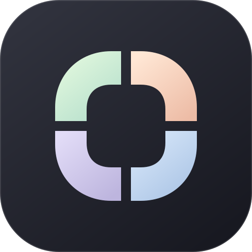

# Oriel 初版首页与视觉设计

- 日期：2026-10-21。
- 范围：无业务功能的应用外壳，单侧边栏与默认首页。
- 关联：[当前设计基线](current-design.md)、[设计决策记录](workspace-and-plugins.md)。

## 用户确认的方向

整体采用浅灰、通透、低对比的工作台外观，左侧为单条窄导航栏。主区域以柔和圆角区块组织，用薄荷绿、蜜桃色、雾蓝与深墨色形成层次。首页先展示 Oriel 品牌与动效，不接入功能，不展示虚构的业务数据。

以下图标、具体色值和构图为本次实现方案，不表示所有视觉细节已经过用户逐项确认。

## 图标：O 与窗

四段带圆角的窗框合成字母 O。中间留空形成“窗”的视野，横竖间隙保留窗格意象；四段柔和色彩也呼应独立工具在同一工作台中各自保留边界。

- 深墨色底保证小尺寸下的识别度。
- 左上薄荷绿、右上蜜桃、左下淡紫、右下雾蓝与页面色彩呼应。
- 不在图标中加入文字，侧栏尺寸和桌面图标尺寸共用同一形状。
- [SVG 原稿](../../public/oriel-icon.svg) 是图标的编辑来源；桌面图标位于 `src-tauri/icons`，触屏图标位于 `public/apple-touch-icon.png`。
- 图标为项目内编写的矢量资源，无远程图片、字体或图片生成服务依赖。

## 页面结构

| 区域 | 内容与职责 |
| --- | --- |
| 单侧边栏 | 品牌图标、唯一的首页导航、外观切换 |
| 页头 | Oriel 名称、个人工作台定位、默认首页标记 |
| 品牌主区块 | Oriel 图标、半透明窗片动效、品牌名称与简短说明 |
| 辅助区块 | 深浅对比的专注主题区块与薄荷色留白区块，均为品牌展示 |
| 工具空间 | 显示工具数量 0 和真实空状态，没有添加按钮或虚构能力 |
| 页脚 | 简短品牌文字与色彩标记 |

首页是当前唯一入口；没有安装功能、设置页面、插件列表、账户、通知、搜索或业务图表。侧栏不放置无作用的占位按钮。首页链接、外观切换和动效暂停是本版实际可用的界面操作。

桌面使用主区块加右侧两个内容区块，右侧内容属于同一首页的网格，不是第二条侧边栏。中等屏幕将辅助区块放到主区块下方，小屏幕变为单列内容，左侧仍保留一条窄导航栏。

## 色彩与排版

| 角色 | 浅色外观 | 深色外观 |
| --- | --- | --- |
| 外部底色 | `#eeedf1` | `#16171e` |
| 应用底色 | `#f3f3f6` | `#1c1d26` |
| 主文字 | `#292b34` | `#efeff5` |
| 次要文字 | `#696b78` | `#b1b2c1` |
| 薄荷区块 | `#deeee5` | 保留粉彩区块，与深色底形成对比 |
| 蜜桃 / 雾蓝 / 淡紫 | `#f5e1d5` / `#dfe7f6` / `#e6e0f0` | 同一色系 |

深色外观保留粉彩色块，将专注区块转换为浅色，形成深浅互换关系。主题选择保存在当前浏览器或 WebView 的本地存储中；存储不可用时只影响偏好记忆，不阻止外观切换。这只是当前界面偏好实现，不决定未来 Oriel 配置文件、数据库或同步方案。

界面优先使用系统字体，Windows 使用 Segoe UI 与微软雅黑回退。标题与品牌字通过字号、字重和间距形成层级，避免依赖在线字体。主圆角为 26px，小屏幕为 21px。

## 动效与可访问性

- 图标轻微浮动和旋转，三层半透明窗片按不同相位缓慢浮动。
- 背景柔光与少量光点配合主图形，以 `transform` 和 `opacity` 驱动动画，不持续改变布局尺寸。
- 暂停按钮控制整组品牌动画，暂停后保持当前画面。
- 系统启用 `prefers-reduced-motion` 时关闭动效并显示“静态展示”。
- 页面隐藏时暂停动画，返回页面后遵循手动暂停状态。
- 导航与按钮具有可访问名称，提供键盘焦点与跳到正文入口；装饰图形对辅助技术隐藏。

## 实现与本轮验证边界

前端为 Vue 3、TypeScript 与 Vite，桌面为最小 Tauri 2 / Rust 外壳。所有视觉资源本地加载；Tauri 不声明宿主命令、业务插件或权限能力。

本轮已执行 `npm run build`，类型检查与前端生产构建通过；已生成 npm 与 Cargo 依赖锁文件及平台图标。按用户要求未运行测试，也未进行浏览器交互验证、桌面运行或桌面安装包构建。

代码中的响应式、键盘焦点及减少动效支持属于实现内容，不等于已完成浏览器或桌面行为验证；前端生产构建通过不代表桌面已验证。

运行方式见[项目说明](../../README.md)。Tauri 工程组织参考[官方项目创建说明](https://v2.tauri.app/start/create-project/)与[配置说明](https://v2.tauri.app/develop/configuration-files/)。
